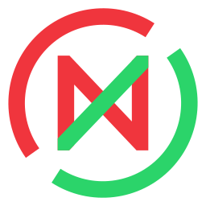
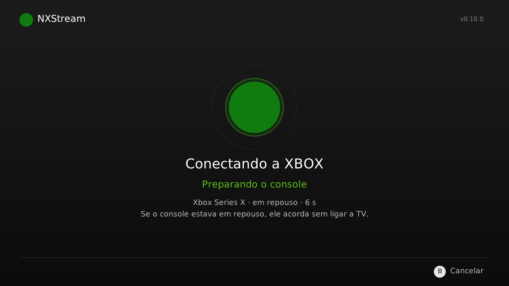
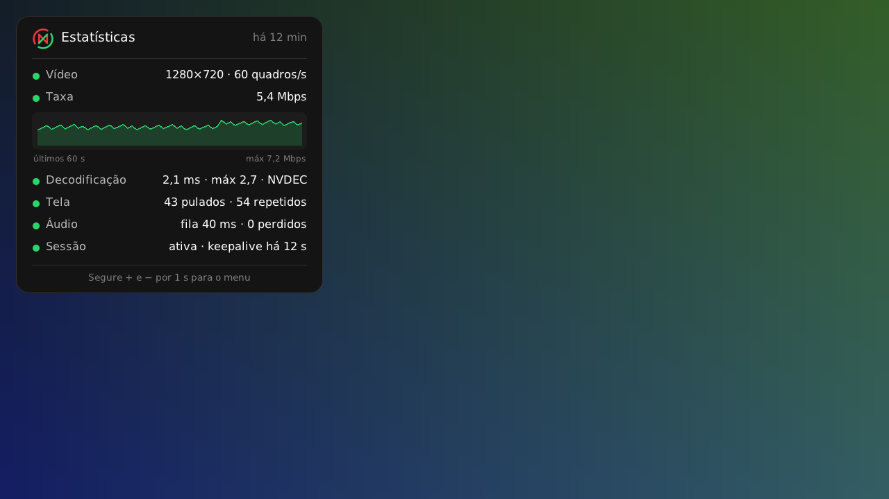
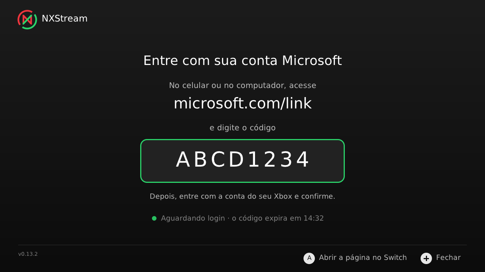
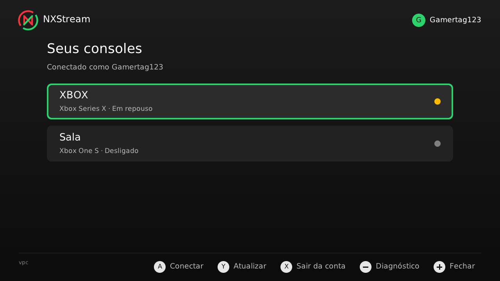
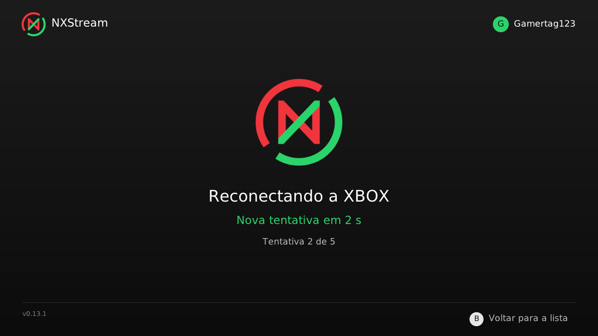
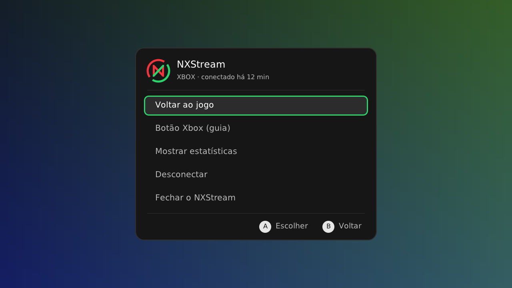

<p align="center"></p>

<h1 align="center">NXStream</h1>

<p align="center">


</p>

**Xbox Remote Play client for Nintendo Switch (homebrew).** Play your own Xbox Series X|S or Xbox One on your Switch over your home network: 720p at 60 fps, hardware video decoding, sound and full controller support.

Built from scratch with a focus on reliability: it reconnects by itself after the Switch sleeps, keeps streaming when you press HOME, and doesn't drop under heavy input.

<p align="center">


</p>

## Features

- **Video:** 1280×720 at 60 fps, H.264 decoded by the Switch's hardware decoder (NVDEC) and drawn by the GPU
- **Audio:** console sound (Opus), kept in sync with the stream
- **Controller:** all buttons and sticks, sent at a fixed rate so bursts of input never flood the connection; Xbox (guide) button through a shortcut
- **Automatic reconnection:** after sleep or a network drop, a new session is opened and the stream comes back by itself (usually 8–13 s, mostly the console waking up)
- **HOME keeps running:** the stream stays connected while you are on the HOME menu
- **Long sessions:** the Xbox Live access token is renewed in the background before it expires (every 4 h)
- **Simple interface** in Brazilian Portuguese, with the Switch's own font: animated connection screen, console list with your gamertag, in-game menu and a statistics card with a live bitrate graph
- **Sign-in once:** Microsoft account login by code (on your phone or in the Switch's browser), saved on the SD card
- **Automatic connection** when your account has a single console; wakes a console in standby without turning on the TV

## Screenshots

| | | |
|---|---|---|
|  |  |  |
| Sign-in by code | Console list with your gamertag | Connecting (animated logo, session state) |
|  |  |  |
| Automatic reconnection | In-game menu (hold + and −) | Statistics card with a 60 s bitrate graph |

Rendered from the app's own UI code on a PC (`make -C tests/ui`); on the Switch the system font is used. More in [docs/TELAS.md](docs/TELAS.md).

## Requirements

- A Switch running custom firmware (Atmosphère) with the Homebrew Menu
- Your Xbox and Switch on the **same network** (xCloud support is in progress: since version 0.12.0 you can list and start cloud games; see the [xCloud roadmap](docs/XCLOUD.md), in Portuguese)
- **Remote features** enabled on the Xbox: *Settings › Devices & connections › Remote features › Enable remote features*, with the power mode set to *Sleep* if you want to wake it from standby

## Installation

1. Download the latest build: open the **Actions** tab, pick the most recent successful run and download the **`NXStream-nro`** artifact (a `.zip` with `NXStream.nro`).
2. Copy `NXStream.nro` to `/switch/NXStream/` on your SD card. To update, just replace the file: your login is kept.
3. Launch it in **title mode**: hold **R** while opening any game and choose NXStream from the Homebrew Menu. Applet mode (from the Album) is not supported.

## Usage

1. On first launch, sign in: go to `microsoft.com/link` on your phone or computer and enter the code shown, or press **A** to open the page in the Switch's browser.
2. Pick your console (or wait: with a single console it connects by itself).
3. Play.

| While streaming | Action |
|---|---|
| Hold **+** and **−** for 1 s | Menu: back to game, Xbox button, statistics card, disconnect, quit |
| Hold **+** and tap **−** | Xbox (guide) button |
| Tap **+** | Xbox Menu button |
| **HOME** | Leave the app; the stream keeps running in the background |

On the console list, **−** opens a WebRTC diagnostic and **X** signs out.

## Roadmap

| Phase | Scope | Status |
|---|---|---|
| 0 | Build pipeline and diagnostics | ✅ Done |
| 1 | Microsoft account sign-in and console list | ✅ Done |
| 2 | Streaming session, WebRTC connection, hardware decoding, video on screen | ✅ Done |
| 3 | Controller and audio | ✅ Done |
| 4 | Reconnection (sleep, network loss, token renewal) and HOME without pausing | 🧪 Testing in daily use |
| 5 | Rumble, settings (quality, deadzone, button mapping), polish | — |

## Documentation (Portuguese)

- [Project plan](docs/PLANO.md): goals, decisions, phases, current status
- [Architecture](docs/ARQUITETURA.md): modules, threads, session state machine, libraries
- [Protocol](docs/PROTOCOLO.md): how Xbox Remote Play works (auth, API, WebRTC) and what was learned from real logs
- [Development](docs/DESENVOLVIMENTO.md): building, testing on the Switch, logs, crash reports, test results per version
- [Screens](docs/TELAS.md): every screen of the app
- [Logo](assets/logo/README.md): logo files and colors

## Troubleshooting

- **Logs:** `/switch/NXStream/NXStream.log` on the SD card. It never contains tokens, so it's safe to share.
- **Crashes:** Atmosphère writes a report to `/atmosphere/crash_reports/`. Download the `NXStream-elf-para-crash-reports` artifact from the **same** build and run `sh scripts/traduzir-crash.sh NXStream.elf <report>.log` to get function names and lines.

## Building locally

Requires [devkitPro](https://devkitpro.org/wiki/Getting_Started) with `switch-dev` and the Switch portlibs (curl, FFmpeg, Opus).

```sh
sh scripts/compilar-deps.sh   # once: builds mbedTLS 3 + libdatachannel into deps/prefix
make                          # produces NXStream.nro
make -C tests                 # parser tests on the PC
make -C tests/ui              # renders the interface screens to images on the PC
```

## Built with

[libnx](https://github.com/switchbrew/libnx) · [libdatachannel](https://github.com/paullouisageneau/libdatachannel) (WebRTC, ported to the Switch) · [mbedTLS](https://github.com/Mbed-TLS/mbedtls) · [FFmpeg](https://ffmpeg.org/) with NVDEC · [deko3d](https://github.com/devkitPro/deko3d) · [libopus](https://opus-codec.org/) · [libcurl](https://curl.se/) · [cJSON](https://github.com/DaveGamble/cJSON) · [stb_truetype and stb_image](https://github.com/nothings/stb)

## License

[GPL-3.0](LICENSE). Derivative works must remain free and open source.

## Disclaimer

NXStream is unofficial homebrew software and is **not affiliated with, endorsed by, or supported by Microsoft Corporation or Nintendo Co., Ltd.** Xbox is a trademark of Microsoft Corporation. Nintendo Switch is a trademark of Nintendo Co., Ltd. These names are used for identification purposes only.

This software is provided "as is", without warranty of any kind. Use at your own risk.
