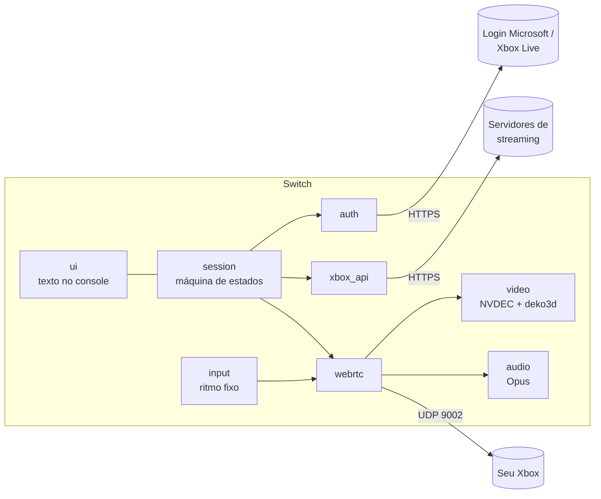
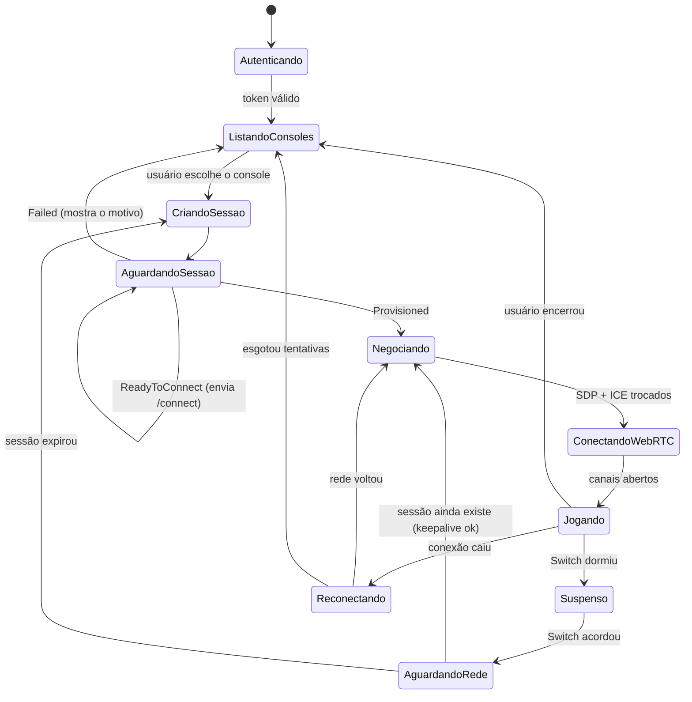

# Arquitetura

## Visão geral



## Módulos

| Módulo | Pasta | Responsabilidade |
|---|---|---|
| `log` | `source/core/` | Log com horário no SD (`/switch/nxstream/nxstream.log`) e no nxlink |
| `auth` | `source/auth/` | Login por código (device code), cadeia de tokens, renovação, armazenamento no SD |
| `xbox_api` | `source/api/` | HTTPS para listar consoles, criar sessão, trocar SDP/ICE, keepalive, encerrar |
| `webrtc` | `source/net/` | Conexão com o console, DTLS/SRTP, canais de dados |
| `video` | `source/media/` | Decodificação H.264 por hardware e desenho na tela |
| `audio` | `source/media/` | Decodificação Opus e saída de som |
| `input` | `source/input/` | Leitura do controle, mapeamento, envio em ritmo fixo, vibração |
| `session` | `source/session/` | Máquina de estados que coordena tudo, incluindo reconexão |
| `ui` | `source/ui/` | Telas em texto: login, lista de consoles, status, erros |

Regra geral: **`auth`, `xbox_api` e a montagem de pacotes de `input` não dependem do libnx** (só de libcurl, cJSON e C padrão). Assim compilam também no PC, e a lógica é testada no CI sem precisar do Switch.

## Threads

| Thread | Função |
|---|---|
| Principal | Desenha a tela, roda `appletMainLoop()` e recebe eventos do sistema (sleep, resume, foco) |
| Rede | WebRTC: recebe pacotes de vídeo e áudio, envia dados |
| Vídeo | Decodifica quadros e entrega para a thread principal desenhar |
| Áudio | Decodifica Opus e alimenta a saída de som |
| Input | A cada ~8 ms, lê o estado do controle e envia **um** pacote com tudo que mudou no intervalo |

O envio em ritmo fixo do input é a correção principal para as quedas com muitos comandos: em vez de um pacote por toque de botão (que inunda o canal numa rajada), sai sempre um pacote por intervalo, com tamanho e frequência previsíveis. Se um envio falhar, o próximo simplesmente leva o estado atualizado. Nada derruba a sessão por isso.

## Máquina de estados da sessão

Todo erro de rede leva a um estado de recuperação, **nunca a fechar o app**. No pior caso, o app volta para a lista de consoles.



Detalhes:
- **Detectar sleep/HOME:** o app usa `AppletFocusHandlingMode_SuspendHomeSleepNotify` e registra os avisos de foco/retomada que o sistema enviar. **Porém, nenhum aviso chega nem no bloqueio (sleep) nem no HOME** (logs da v0.2.2 e v0.2.3). Por isso o sinal principal compara o tempo entre quadros: mais de 1,5 s parado significa suspensão. O tempo gasto em chamadas HTTP é descontado (o módulo `http` avisa ao fim de cada requisição), senão uma resposta lenta da rede seria confundida com sleep. Ao acordar, a rede já está disponível de imediato, então a reconexão pode começar sem espera.
- **Reconectando** usa espera crescente entre tentativas (1 s, 2 s, 4 s… até um limite) e mostra na tela o que está acontecendo.
- **Keepalive** roda numa rotina própria enquanto a sessão existe, inclusive durante a reconexão, para o servidor não encerrar a sessão.
- Os tempos (intervalo do keepalive, número de tentativas, tempo de espera da rede) ficam em constantes ajustáveis, calibradas com os testes no Switch.

## Bibliotecas

| Biblioteca | Uso | Origem |
|---|---|---|
| libnx | Base do homebrew: rede, controle, áudio, applet | devkitPro |
| libcurl + mbedTLS | HTTPS | pacotes `switch-curl`, `switch-mbedtls` do devkitPro |
| cJSON | JSON | arquivo único em `third_party/` |
| WebRTC | Ver abaixo | — |
| FFmpeg (fork do averne) | Decodificação H.264 pelo NVDEC | compilado no CI, com cache |
| deko3d | Desenho do vídeo na tela (shader NV12 → RGB) | pacote `switch-deko3d` |
| libopus | Decodificação de áudio | pacote `switch-libopus` |

### WebRTC

É a escolha mais importante do projeto.

| Opção | Prós | Contras |
|---|---|---|
| **libdatachannel** (C++) | Robusta, mantida, usada em produção, SCTP maduro | Precisa ser portada para o Switch (depende de libjuice, usrsctp, mbedTLS) |
| **libpeer** (C) | Pequena, feita para dispositivos embarcados | Foi a usada pelo LibNXbox; suspeita de ser fonte da fragilidade |

Plano: tentar portar a libdatachannel primeiro. Se não for viável, usar a libpeer com o envio de input em ritmo fixo e tratamento de erro mais cuidadoso. A decisão final é registrada aqui quando a fase 2 começar.

## Estrutura de pastas planejada

```
nxstream/
├── source/
│   ├── main.c
│   ├── core/       log, utilidades
│   ├── auth/       login e tokens
│   ├── api/        API de streaming (config.h com endpoints)
│   ├── net/        WebRTC
│   ├── media/      vídeo e áudio
│   ├── input/      controle
│   ├── session/    máquina de estados
│   └── ui/         telas em texto
├── third_party/    bibliotecas incluídas no código (cJSON etc.)
├── tests/          testes que rodam no PC/CI
├── docs/           esta documentação
└── .github/workflows/build.yml
```
