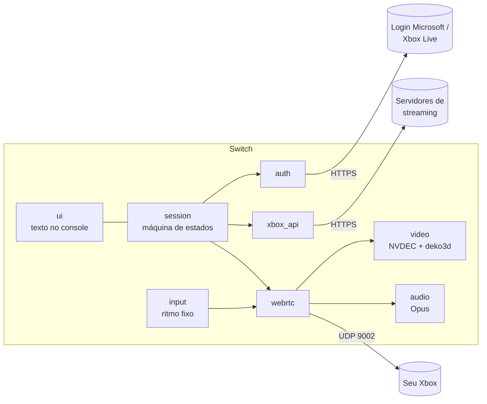
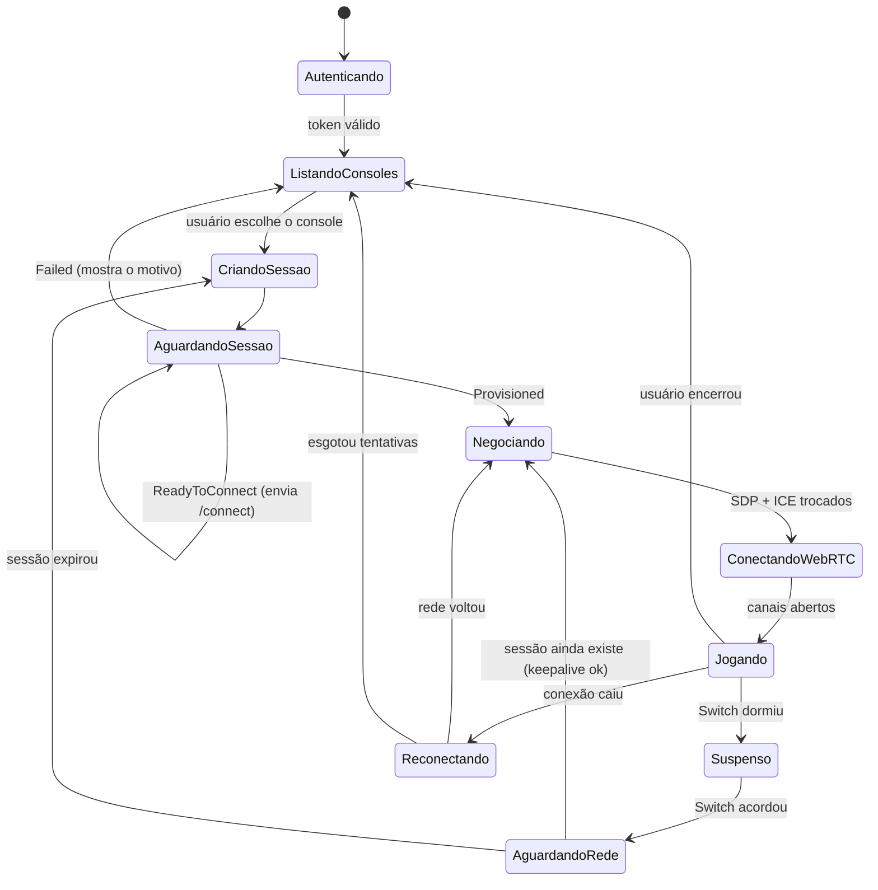

# Arquitetura

## Visão geral



## Módulos

| Módulo | Pasta | Responsabilidade |
|---|---|---|
| `log` | `source/core/` | Log com horário no SD (`/switch/NXStream/NXStream.log`) e no nxlink |
| `http` | `source/core/` | HTTPS pelo libcurl. Mantém até 4 handles reaproveitáveis (um por thread em uso) para não refazer TCP + TLS a cada chamada; `http_descartar_conexoes()` depois de um repouso |
| `auth` | `source/auth/` | Login por código (device code), cadeia de tokens, renovação, armazenamento no SD |
| `xbox_api` | `source/api/` | HTTPS para listar consoles, criar sessão, trocar SDP/ICE, keepalive, encerrar |
| `webrtc` | `source/net/` | Conexão com o console, DTLS/SRTP, canais de dados |
| `video` | `source/media/` | `h264_info`: tipos de NAL, quadro-chave e resolução (SPS), testado no PC. `decodificador`: fila de até 8 quadros e thread própria que decodifica pelo NVDEC (FFmpeg do devkitPro, `AV_HWDEVICE_TYPE_NVTEGRA`); se a fila encher, descarta até o próximo quadro-chave e pede um ao console; o quadro pronto mais recente fica guardado para a tela. `video_tela`: desenho pela GPU com o deko3d; a memória de cada quadro do NVDEC vira um bloco da GPU (luma R8 + croma RG8 no layout de vídeo, sem cópia, como no Moonlight-Switch) e um shader converte NV12 → RGB (BT.709/601). Os shaders ficam em `shaders/`, compilados pelo `uam` no build e embutidos no executável |
| `audio` | `source/media/` | `audio`: RTP → Opus (libopus se o build encontrar; senão o Opus do FFmpeg) → fila de até 200 ms (mantida perto de 60 ms) → thread de saída com blocos de 20 ms no `audout` |
| `input` | `source/input/` | `controle`: botões e analógicos do Switch → controle do Xbox, por posição (B do Switch = A do Xbox). `pacote_input`: monta o pacote do canal `input` (testado no PC). Um pacote por quadro de tela, com os metadados dos quadros exibidos. Depois: vibração e mapeamento configurável (fase 5) |
| `session` | `source/session/` | Máquina de estados que coordena tudo, incluindo reconexão |
| `ui` | `source/ui/` | `tela` (v0.10.0): interface gráfica desenhada pela CPU no framebuffer do libnx, com a fonte do sistema (stb_truetype) e o logo em PNG embutido (stb_image): status com o logo pulsando, login por código, mensagens, lista, menu e cartão de estatísticas do streaming (ver [TELAS.md](TELAS.md)). A janela é de um de cada vez: interface, console de texto (só o diagnóstico) ou GPU (vídeo). `sobreposicao`: imagem RGBA por cima do vídeo, onde entram o menu e o cartão de estatísticas (desenhados pela `tela`) e avisos curtos em texto |

Regra geral: **`auth`, `xbox_api` e a montagem de pacotes de `input` não dependem do libnx** (só de libcurl, cJSON e C padrão). Assim compilam também no PC, e a lógica é testada no CI sem precisar do Switch.

## Threads

| Thread | Função |
|---|---|
| Principal | Desenha a tela, roda `appletMainLoop()` e recebe eventos do sistema (sleep, resume, foco) |
| Chamada de rede (v0.10.6) | Durante as telas animadas, cada chamada HTTP (login, lista, estado da sessão, SDP, candidatos) roda numa thread curta enquanto a principal segue desenhando a 60 quadros/s (`chamar()` em `main.c`) |
| Rede | WebRTC: recebe pacotes de vídeo e áudio, envia dados |
| Vídeo | Decodifica quadros e entrega para a thread principal desenhar |
| Áudio | Decodifica Opus e alimenta a saída de som |
| Input | A cada ~8 ms, lê o estado do controle e envia **um** pacote com tudo que mudou no intervalo |

O envio em ritmo fixo do input é a correção principal para as quedas com muitos comandos: em vez de um pacote por toque de botão (que inunda o canal numa rajada), sai sempre um pacote por intervalo, com tamanho e frequência previsíveis. Se um envio falhar, o próximo simplesmente leva o estado atualizado. Nada derruba a sessão por isso.

## Máquina de estados da sessão

Todo erro de rede leva a um estado de recuperação, **nunca a fechar o app**. No pior caso, o app volta para a lista de consoles.



Detalhes:
- **Detectar sleep/HOME:** o app usa `AppletFocusHandlingMode_SuspendHomeSleepNotify` e registra os avisos de foco/retomada que o sistema enviar. **Porém, nenhum aviso chega nem no bloqueio (sleep) nem no HOME** (logs da v0.2.2 e v0.2.3). Por isso o sinal principal compara o tempo entre quadros: mais de 1,5 s parado significa suspensão. O tempo gasto em chamadas HTTP é descontado (o módulo `http` avisa ao fim de cada requisição), senão uma resposta lenta da rede seria confundida com sleep. Ao acordar, a rede já está disponível de imediato, então a reconexão pode começar sem espera.
- **Reconectando** usa espera crescente entre tentativas (1 s, 2 s, 4 s… até um limite) e mostra na tela o que está acontecendo.
- **Implementado na v0.9.0** (`passo_sessao` em `main.c`): queda = conexão fora de "conectado" por mais de 4 s, "falhou"/"fechado", ou volta do repouso com mais de 2 s parado. Refaz só a conexão WebRTC na mesma sessão (até 5 tentativas: 0,5, 1, 2, 4, 8 s); se não der, encerra a sessão e abre outra (mais 5 tentativas). Uma tentativa que chega a conectar zera a contagem. HOME não pausa o app (`AppletFocusHandlingMode_NoSuspend`): fora de foco ele não desenha, solta os quadros e manda o controle parado, mas mantém conexão, keepalive e som.
- **Keepalive** roda numa rotina própria enquanto a sessão existe, inclusive durante a reconexão, para o servidor não encerrar a sessão.
- Os tempos (intervalo do keepalive, número de tentativas, tempo de espera da rede) ficam em constantes ajustáveis, calibradas com os testes no Switch.

## Bibliotecas

| Biblioteca | Uso | Origem |
|---|---|---|
| libnx | Base do homebrew: rede, controle, áudio, applet | devkitPro |
| libcurl + mbedTLS | HTTPS | pacotes `switch-curl`, `switch-mbedtls` do devkitPro |
| cJSON | JSON | arquivo único em `third_party/` |
| WebRTC | Ver abaixo | — |
| FFmpeg (fork do averne) | Decodificação H.264 pelo NVDEC | compilado no CI, com cache |
| deko3d | Desenho do vídeo na tela (shader NV12 → RGB) | pacote `switch-deko3d` |
| libopus | Decodificação de áudio | pacote `switch-libopus` |

### WebRTC

É a escolha mais importante do projeto.

| Opção | Prós | Contras |
|---|---|---|
| **libdatachannel** (C++) | Robusta, mantida, usada em produção, SCTP maduro | Precisa ser portada para o Switch (depende de libjuice, usrsctp, mbedTLS) |
| **libpeer** (C) | Pequena, feita para dispositivos embarcados | Foi a usada pelo LibNXbox; suspeita de ser fonte da fragilidade |

Plano: tentar portar a libdatachannel primeiro. Se não for viável, usar a libpeer com o envio de input em ritmo fixo e tratamento de erro mais cuidadoso. A decisão final é registrada aqui quando a fase 2 começar.

#### Experimento de port (fase 2b, workflow `experimento-webrtc.yml`)

O que a imagem `devkitpro/devkita64` oferece:
- **FFmpeg 7.1 com `--enable-nvtegra`** (`hwcontext_nvtegra.h` presente): a decodificação por hardware da fase 2c já vem pronta, sem compilar FFmpeg próprio.
- libopus, libcurl 7.69 (TLS libnx), zlib, CMake 3.31 com `Switch.cmake`.
- **mbedTLS 2.28**, mas a libdatachannel exige **3.x**.

Resultado: ✅ **a libdatachannel compila inteira para o Switch**, com as três dependências (libjuice, libSRTP, usrsctp) e o mbedTLS 3.6.2, sem erros. Foram necessários:

1. **mbedTLS 3.6.2** compilado pelo projeto (a imagem só tem a 2.28), com `MBEDTLS_SSL_DTLS_SRTP`; sem `NET_C`, `TIMING_C`, armazenamento PSA e TLS 1.3; com `MBEDTLS_FATAL_WARNINGS=OFF` (aviso novo do GCC 15), `MBEDTLS_PLATFORM_MS_TIME_ALT` e `MBEDTLS_ENTROPY_HARDWARE_ALT`. **`MBEDTLS_FS_IO` deve ficar ligado** (a libdatachannel lê certificados de arquivo). O app precisa fornecer `mbedtls_ms_time()` e `mbedtls_hardware_poll()`.
2. **Caminhos do mbedTLS 3** passados via `-D` para os módulos de busca da libdatachannel (`MbedTLS_*`) e da libSRTP (`MBEDTLS_*`), para não pegar o 2.28 da imagem.
3. **Camada `compat/`** (ver `compat/README.md`): `sys/uio.h`, `sys/socket.h` (`CMSG_ALIGN`), `errno.h` (`ERESTART`), `netinet/in.h`, `netinet/in_systm.h`, `netinet/ip.h`, `ifaddrs.h` + `getifaddrs()` com o IP do Switch, e `_DEFAULT_SOURCE` para os tipos BSD.
4. **Patches nas dependências** (`compat/patches/aplicar.py`): gerador aleatório seguro do Switch (`randomGet`) na usrsctp e na libjuice; buffers do socket UDP da libjuice reduzidos no Switch; `struct sockaddr_conn` da usrsctp no formato BSD no Switch (junto com `HAVE_SCONN_LEN` em `compat.cmake`), senão o SCTP falha com `EAFNOSUPPORT` ou corrompe memória.
5. **Rede da libnx com mais memória** (`socketInitialize` com `sb_efficiency = 8` e 6 sessões BSD): todos os sockets do app dividem um poço de buffers de tamanho fixo, e com o padrão a conexão WebRTC deixava o HTTPS sem espaço (fase 2b, v0.4.1).

**Validado em execução no Switch (v0.3.0, diagnóstico sem o Xbox):** certificado DTLS + oferta SDP (vídeo H.264, áudio Opus, canal de dados) em 0,01 s; coleta de candidatos completa em 0,05 s com o IP do Switch; criar e destruir conexões repetidas vezes sem travar. Isso exercita threads, sockets, `poll()`, o `pipe()` e a `getifaddrs()` da camada compat, e a entropia do Switch no mbedTLS 3.

Essas três dependências (usrsctp e libSRTP, além do mbedTLS) também são usadas pela libpeer, então a camada de compatibilidade serve aos dois caminhos.

## Estrutura de pastas planejada

```
NXStream/
├── source/
│   ├── main.c
│   ├── core/       log, utilidades
│   ├── auth/       login e tokens
│   ├── api/        API de streaming (config.h com endpoints)
│   ├── net/        WebRTC
│   ├── media/      vídeo e áudio
│   ├── input/      controle
│   ├── session/    máquina de estados
│   └── ui/         telas em texto e texto por cima do vídeo
├── shaders/        shaders da GPU (GLSL, compilados pelo uam)
├── third_party/    bibliotecas incluídas no código (cJSON etc.)
├── tests/          testes que rodam no PC/CI
├── docs/           esta documentação
└── .github/workflows/build.yml
```
