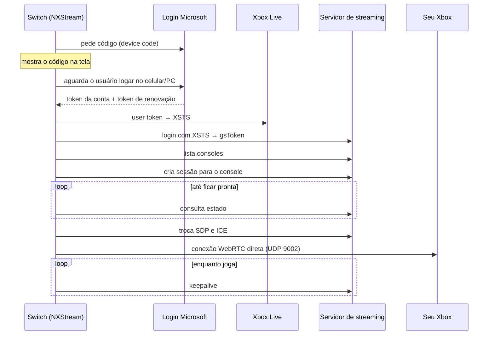

# Protocolo do Xbox Remote Play

Como o streaming do console próprio funciona, segundo os clientes de referência. Itens marcados **(a confirmar)** ainda não foram testados pelo NXStream e serão verificados na fase indicada.

> A Microsoft pode mudar qualquer parte disto sem aviso. Ao encontrar diferenças, atualize este documento e o `source/api/config.h`.

## Visão geral



## 1. Autenticação (fase 1)

Fonte: [`xal-node`](https://github.com/unknownskl/xal-node) (`src/msal.ts`), a biblioteca de autenticação usada pelo Greenlight. Implementação no NXStream: `source/auth/`. Endereços em `source/api/config.h`.

| # | Etapa | Requisição | Resultado |
|---|---|---|---|
| 1 | Pedir código | `POST login.microsoftonline.com/consumers/oauth2/v2.0/devicecode` (formulário: `client_id`, `scope=xboxlive.signin openid profile offline_access`) | `user_code`, `device_code`, `verification_uri`, `expires_in`, `interval` |
| 2 | Aguardar login | `POST .../oauth2/v2.0/token` com `grant_type=urn:ietf:params:oauth:grant-type:device_code`, a cada `interval` segundos | Enquanto pendente: HTTP 400 `authorization_pending` (ou `slow_down`). Depois: `access_token` + `refresh_token` |
| 3 | Renovar (próximas aberturas) | `POST .../oauth2/v2.0/token` com `grant_type=refresh_token` | Novos `access_token` e `refresh_token`. HTTP 400 `invalid_grant` = precisa logar de novo |
| 4 | User token | `POST user.auth.xboxlive.com/user/authenticate`, JSON com `AuthMethod: RPS`, `RpsTicket: "d=<access_token>"`, `RelyingParty: http://auth.xboxlive.com` | `Token` |
| 5 | XSTS | `POST xsts.auth.xboxlive.com/xsts/authorize`, JSON com `SandboxId: RETAIL`, `UserTokens: [<token>]`, `RelyingParty: http://gssv.xboxlive.com/` | `Token` (+ gamertag em `DisplayClaims.xui[0].gtg`, quando enviado). Erros trazem `XErr` (ex.: 2148916233 = conta sem perfil Xbox) |
| 6 | Token de streaming | `POST xhome.gssv-play-prod.xboxlive.com/v2/login/user`, JSON `{token, offeringId: "xhome"}`, header `x-gssv-client: XboxComBrowser` | `gsToken`, `durationInSeconds` (~4 h) e `offeringSettings.regions[]` (usa a com `isDefault: true`, campo `baseUri`) |

Observações:
- O `client_id` é o público do app Xbox, o mesmo usado por xal-node/Greenlight.
- **A Microsoft troca o refresh token a cada renovação.** O app salva o novo sempre que renova, senão o login "some" na abertura seguinte.
- Só o refresh token é salvo em disco (`/switch/nxstream/token.json`). Os demais são obtidos a cada abertura. Nenhum token é escrito no log.
- O HTTPS usa o TLS nativo do Switch (libcurl do devkitPro com backend libnx), com os certificados do próprio sistema. Se algum servidor falhar na verificação, colocar um `cacert.pem` em `/switch/nxstream/` faz o app usá-lo no lugar.

## 2. API de streaming do console (fases 1 e 2)

Endereço base: o `baseUri` da região padrão retornada na etapa 6 (formato: `https://<região>.core.gssv-play-prodxhome.xboxlive.com`).

Headers de todas as chamadas: `Authorization: Bearer <gsToken>`, `X-Gssv-Client: XboxComBrowser`, `X-MS-Device-Info: <JSON do cliente>` (ver `NX_DEVICE_INFO` em `config.h`).

Resposta de `/v6/servers/home`: `results[]` com `deviceName`, `serverId`, `powerState` (`On`, `ConnectedStandby`...), `consoleType` (`XboxSeriesX`...).

| Método | Caminho | Para quê |
|---|---|---|
| `GET` | `/v6/servers/home` | Lista os consoles da conta e seus estados |
| `POST` | `/v5/sessions/home/play` | Cria a sessão para um console (`serverId`) com as configurações do cliente |
| `GET` | `/v5/sessions/home/{id}/state` | Estado atual da sessão |
| `GET` | `/v5/sessions/home/{id}/configuration` | Configuração da sessão |
| `POST` | `/v5/sessions/home/{id}/connect` | Envia um token de usuário quando o estado é `ReadyToConnect` |
| `POST` / `GET` | `/v5/sessions/home/{id}/sdp` | Envia a oferta SDP / consulta a resposta |
| `POST` / `GET` | `/v5/sessions/home/{id}/ice` | Envia / recebe candidatos ICE |
| `POST` | `/v5/sessions/home/{id}/keepalive` | Mantém a sessão viva |
| `DELETE` | `/v5/sessions/home/{id}` | Encerra a sessão **(a confirmar)** |

Consultas a `/sdp` e `/ice` podem responder `204` (ainda sem dados): é preciso repetir até vir conteúdo.

### Abrir e manter a sessão (fase 2a)

Fonte: Greenlight (`xcloudapi.ts`, `streammanager.ts`) e xbox-xcloud-player (`apiclient.ts`). Implementação: `source/api/xapi.c`.

1. **Criar:** `POST /v5/sessions/home/play` com `serverId` do console, `titleId` vazio e `settings` (`nanoVersion: "V3;WebrtcTransport.dll"`, `sdkType: "web"`, `osName: "windows"`, `locale`...). A resposta traz `sessionId`, `sessionPath` (ex.: `v5/sessions/home/<id>`) e `state`. Todas as chamadas seguintes usam `<baseUri>/<sessionPath>/...`.
2. **Acompanhar:** `GET <sessionPath>/state` a cada 1 s até `Provisioned`.
3. **Autorizar:** quando o estado for `ReadyToConnect`, obter um token de transferência em `POST login.live.com/oauth20_token.srf` (`grant_type=refresh_token`, `scope=service::http://Passport.NET/purpose::PURPOSE_XBOX_CLOUD_CONSOLE_TRANSFER_TOKEN`, mesmo `client_id` e refresh token do login) e enviar `POST <sessionPath>/connect` com `{"userToken": "<access_token>"}`. Esse token não substitui o refresh token salvo.
4. **Manter viva:** `POST <sessionPath>/keepalive` (corpo `{}`) a cada 30 s, **somente depois que a conexão WebRTC com o console estiver estabelecida** (o Greenlight inicia o keepalive no evento `connected`). **Confirmado na fase 2b (v0.4.4):** com a conexão WebRTC aberta, o keepalive responde HTTP 200 `{"aliveSeconds":null,"reason":"None"}`. Na fase 2a, com a sessão `Provisioned` mas sem conexão WebRTC, o servidor respondia a todo keepalive com HTTP 400 `{"code":"SessionInUnexpectedState","message":"KeepAlive : ServerStreamingStarted"}`. Ou seja, o console já começou a transmitir (`ServerStreamingStarted`) e o keepalive não é aceito nesse estado. Isso bate com o Greenlight, que só inicia o keepalive depois de conectar. Confirmação final na fase 2b, com o keepalive enviado já com a conexão aberta.
5. **Encerrar:** `DELETE <sessionPath>`.

Observações da fase 2a (Xbox Series X, rede local):
- Console em repouso: `Provisioning` → `Provisioned` em ~11 s, **sem passar por `ReadyToConnect`** (o `/connect` não foi necessário com o console próprio). O código continua tratando `ReadyToConnect` caso aconteça.
- Sem cliente conectado, a sessão continuou `Provisioned` por quase 6 minutos (o `DELETE` respondeu HTTP 202).
- A sessão **sobrevive à suspensão do Switch** (sleep e HOME): após 18, 23, 37, 63, 98 e 190 s suspenso, o `/state` continuou `Provisioned`. Limite máximo ainda não medido.
- Console já ligado: pronta em ~5 s (contra ~11 s a partir do repouso).
- Com a conexão WebRTC aberta, um sleep de 282 s derrubou a conexão (os sockets morrem no sleep), mas **a sessão continuou viva** (keepalive HTTP 200 logo ao acordar). Reconectar exige só refazer a negociação WebRTC, não uma sessão nova (fase 4).

Abrir uma sessão com o console em repouso o acorda apenas no modo de streaming: o LED não acende por completo e o HDMI/TV não é acionado. É o mesmo comportamento do app oficial; não existe comando separado de "ligar".

### Estados da sessão

| Estado | Significado | Ação do app |
|---|---|---|
| `Provisioning` | Sessão sendo preparada | Consultar de novo após um intervalo |
| `ReadyToConnect` | Servidor espera um token de usuário | Obter token específico de transferência para console e enviar em `/connect`; depois voltar a consultar |
| `Provisioned` | Pronta | Iniciar a troca de SDP/ICE |
| `WaitingForResources` | Fila (mais comum no xCloud) | Consultar de novo |
| `Failed` | Falhou | Mostrar `errorDetails` e voltar para a lista de consoles |

## 3. WebRTC (fase 2b)

Fonte: pacote `player` do Greenlight (`packages/player/src/client/lib/` e `src/server/index.ts`), a versão mantida do cliente. Implementação: `source/net/conexao.c` e `source/api/xapi.c`.

### 3.1 Oferta local

- Conexão **sem servidores ICE** (rede local: só candidatos `host`).
- Mídias:
  - **áudio** Opus, `sendrecv` (o canal de voz usa a mesma trilha); o player acrescenta `stereo=1` ao `fmtp`;
  - **vídeo** H.264, `recvonly`, preferência pelo perfil Main (`profile-level-id=4d…`), depois Constrained Baseline (`42e…`).
- **Canais de dados**, criados nesta ordem, todos ordenados (`ordered`):

| Nome | Protocolo |
|---|---|
| `chat` | `chatV1` |
| `control` | `controlV1` |
| `input` | `1.0` |
| `message` | `messageV1` |

### 3.2 Troca de SDP

`POST <sessionPath>/sdp`:

```json
{"messageType":"offer","sdp":"<oferta>","requestId":"1",
 "configuration":{
   "chatConfiguration":{"bytesPerSample":2,"expectedClipDurationMs":20,
     "format":{"codec":"opus","container":"webm"},"numChannels":1,"sampleFrequencyHz":24000},
   "chat":{"minVersion":1,"maxVersion":1},
   "control":{"minVersion":1,"maxVersion":3},
   "input":{"minVersion":1,"maxVersion":9},
   "message":{"minVersion":1,"maxVersion":1},
   "reliableinput":{"minVersion":9,"maxVersion":9},
   "unreliableinput":{"minVersion":9,"maxVersion":9}}}
```

`GET <sessionPath>/sdp` até sair do HTTP 204. A resposta traz `exchangeResponse`, um **texto JSON dentro do JSON**, com `sdp` (a resposta do console) e eventualmente `errorDetails`.

### 3.3 Troca de candidatos (ICE)

Depois de aplicar a resposta, `POST <sessionPath>/ice` com `{"candidates": [<texto JSON>, ...]}`, em que cada item é o texto de `{"candidate":"candidate:…","sdpMid":"0","sdpMLineIndex":0,"usernameFragment":"<ice-ufrag>"}`.

`GET <sessionPath>/ice` até sair do HTTP 204. `exchangeResponse` traz uma lista de `{candidate, sdpMid, sdpMLineIndex, messageType}`:
- `a=end-of-candidates` é ignorado.
- **No NXStream (só rede local), apenas candidatos IPv4 de rede privada são usados** (10/8, 172.16/12, 192.168/16, 169.254/16). O Xbox também envia IPv6, o IP público (srflx) e os derivados de Teredo; na libnx, o IPv6 não é suportado e os públicos disparam DNS reverso. Observado (v0.4.3): a conexão costuma subir **antes** de os candidatos do console chegarem, porque o console alcança o Switch pelo candidato local que enviamos.
- Endereço **Teredo** (IPv6 começando com `2001:`): o console anuncia assim. Extrair o IPv4 e a porta (os últimos 32 bits e os bits 80–95, invertidos) e adicionar dois candidatos `host` extras, com a **porta 9002** e com a porta extraída, além do original.

### 3.4 Abertura dos canais (handshake)

1. Canal `message` abre → cliente envia `{"type":"Handshake","version":"messageV1","id":"<uuid>","cv":"0"}`.
2. Console responde `HandshakeAck` → cliente:
   - envia no `control`: `{"message":"authorizationRequest","accessKey":"4BDB3609-C1F1-4195-9B37-FEFF45DA8B8E"}`, depois `{"message":"gamepadChanged","gamepadIndex":0,"wasAdded":true}` e `…"wasAdded":false}` (o player envia os dois);
   - envia no `input` o **pacote de metadados do cliente** (15 bytes, little-endian): `u16 tipo=8`, `u32 sequência=0`, `f64 tempo em ms`, `u8 máximo de toques=1`;
   - envia no `message` as configurações, cada uma como `{"type":"Message","content":"<JSON>","id":"<uuid>","target":"<caminho>","cv":""}`: `/streaming/systemUi/configuration`, `/streaming/properties/clientappinstallidchanged`, `/streaming/characteristics/orientationchanged`, `…/touchinputenabledchanged`, `…/clientdevicecapabilities` e `…/dimensionschanged` (o NXStream pede 1280×720).
3. Mensagens de texto são enviadas como **binário** (UTF-8), não como mensagem de texto do WebRTC.

O keepalive (seção 2) só é aceito com a conexão aberta.

### 3.5 Resposta SDP do console (observado na v0.4.5)

- Vídeo: o console escolhe H.264 **Main, nível 4.2** (`profile-level-id=4d002a`; alternativa Baseline `42e02a`), `sendonly`, com `a=imageattr:102 send [x=[0:2560],y=[0:1440],fps=[0:60]]` (até 2560×1440 a 60 fps).
- Áudio: Opus 48 kHz, `sendrecv`, sem `stereo=1` no `fmtp` da resposta.
- `a=ice-options:trickle renomination`, `a=setup:passive` (o Switch é o cliente DTLS).

### 3.6 Resolução do vídeo

- O console **ignora** o tamanho pedido em `/streaming/characteristics/dimensionschanged` para decidir a resolução.
- Os clientes de referência escolhem a resolução pelo `dev.os.name` do `X-MS-Device-Info` enviado ao criar a sessão: `"android"` para 720p, `"windows"` para 1080p.
- Observado (v0.5.0, Xbox Series X): com `"windows"`, o console enviou **2560×1440 a 60 fps**, H.264 Main nível 5.1, 17–29 Mbps, quadros-chave a cada 30 s (até ~450 KB). O NXStream passou a usar `"android"` (`NX_OS_RESOLUCAO` em `config.h`); resultado a confirmar.

### 3.7 Primeiras mensagens do console (observado na v0.4.3)

- `control`, ao abrir: `{"dataChannelOnlySessionCount":0,"message":"dataChannelOnlySessionCountChanged"}`
- `chat`: abre e é fechado pelo console logo em seguida (voz não negociada).
- `input`, depois dos metadados do cliente: 10 bytes `10 00 70 08 00 00 00 0f 00 00`.
- `message`: `HandshakeAck`, depois `Message` em `/streaming/properties/titleinfo` e `/streaming/touchcontrols/showlayoutv2`.
- Vídeo: primeiro pacote RTP (44 bytes) logo após a conexão.

## Referências

- [unknownskl/xbox-xcloud-player](https://github.com/unknownskl/xbox-xcloud-player): cliente de referência do protocolo (TypeScript). Principal fonte para API e formato do input.
- [unknownskl/greenlight](https://github.com/unknownskl/greenlight): cliente desktop completo e mantido. Referência para estados da sessão, autenticação e, no pacote `player`, a negociação WebRTC e os canais.
- [OpenXbox / xcloud-rs](https://github.com/OpenXbox): engenharia reversa do backend.
- [XITRIX/Moonlight-Switch](https://github.com/XITRIX/Moonlight-Switch): decodificação por hardware e renderização no Switch.
