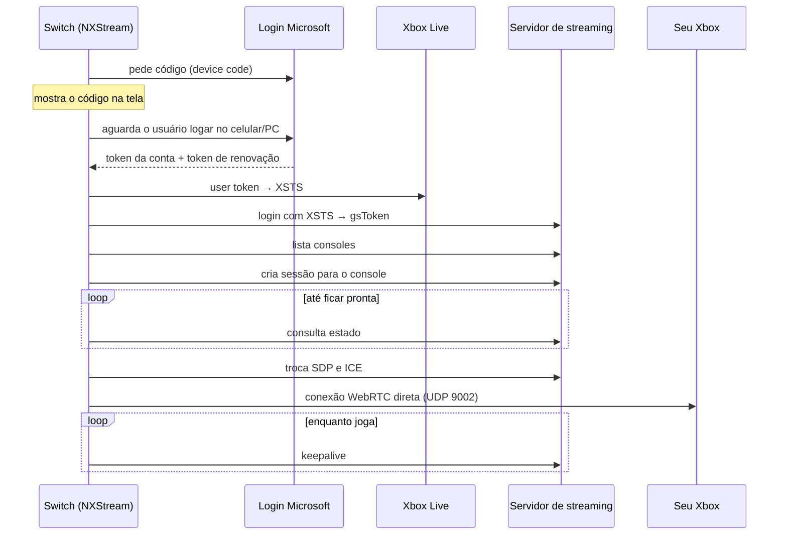

# Protocolo do Xbox Remote Play

Como o streaming do console próprio funciona, segundo os clientes de referência. Itens marcados **(a confirmar)** ainda não foram testados pelo NXStream e serão verificados na fase indicada.

> A Microsoft pode mudar qualquer parte disto sem aviso. Ao encontrar diferenças, atualize este documento e o `source/api/config.h`.

## Visão geral

## 1. Autenticação (fase 1)

1. **Login por código (device code).** O app pede um código à Microsoft, mostra na tela, e o usuário digita em microsoft.com/link no celular ou PC. O app consulta periodicamente até o login ser concluído. Recebe um token de acesso e um **token de renovação**.
2. **User token do Xbox Live** a partir do token da conta. **(a confirmar)**
3. **Token XSTS** para o serviço de streaming. **(a confirmar)**
4. **gsToken:** login no servidor de streaming com o XSTS. A resposta traz o gsToken e o endereço do servidor regional a usar. **(a confirmar)**

Só o token de renovação é salvo em disco (`/switch/nxstream/token.json`). Os demais são renovados a partir dele a cada abertura do app.

## 2. API de streaming do console (fases 1 e 2)

Endereço base: o servidor regional retornado no login (formato visto nas referências: `https://<região>.core.gssv-play-prodxhome.xboxlive.com`). Todas as chamadas levam o gsToken.

| Método | Caminho | Para quê |
|---|---|---|
| `GET` | `/v6/servers/home` | Lista os consoles da conta e seus estados |
| `POST` | `/v5/sessions/home/play` | Cria a sessão para um console (`serverId`) com as configurações do cliente |
| `GET` | `/v5/sessions/home/{id}/state` | Estado atual da sessão |
| `GET` | `/v5/sessions/home/{id}/configuration` | Configuração da sessão |
| `POST` | `/v5/sessions/home/{id}/connect` | Envia um token de usuário quando o estado é `ReadyToConnect` |
| `POST` / `GET` | `/v5/sessions/home/{id}/sdp` | Envia a oferta SDP / consulta a resposta |
| `POST` / `GET` | `/v5/sessions/home/{id}/ice` | Envia / recebe candidatos ICE |
| `POST` | `/v5/sessions/home/{id}/keepalive` | Mantém a sessão viva |
| `DELETE` | `/v5/sessions/home/{id}` | Encerra a sessão **(a confirmar)** |

Consultas a `/sdp` e `/ice` podem responder `204` (ainda sem dados): é preciso repetir até vir conteúdo.

### Estados da sessão

| Estado | Significado | Ação do app |
|---|---|---|
| `Provisioning` | Sessão sendo preparada | Consultar de novo após um intervalo |
| `ReadyToConnect` | Servidor espera um token de usuário | Obter token específico de transferência para console e enviar em `/connect`; depois voltar a consultar |
| `Provisioned` | Pronta | Iniciar a troca de SDP/ICE |
| `WaitingForResources` | Fila (mais comum no xCloud) | Consultar de novo |
| `Failed` | Falhou | Mostrar `errorDetails` e voltar para a lista de consoles |

## 3. WebRTC (fases 2 e 3)

Conexão direta com o console, na rede local pela porta UDP 9002. Criptografia DTLS-SRTP.

| Canal | Tipo | Conteúdo |
|---|---|---|
| Vídeo | Mídia (RTP) | H.264 |
| Áudio | Mídia (RTP) | Opus, 48 kHz, estéreo |
| `input` | Dados (SCTP) | Estado do gamepad (formato binário próprio) e vibração vinda do console **(a confirmar)** |
| `control` | Dados | Pedido de quadro-chave, eventos de controle **(a confirmar)** |
| `message` | Dados | Handshake inicial em JSON e eventos do sistema **(a confirmar)** |
| `chat` | Dados | Voz (não será usado) |

O formato binário do input e a sequência de inicialização dos canais serão documentados aqui durante a fase 2, conferindo com `xbox-xcloud-player`.

## Referências

- [unknownskl/xbox-xcloud-player](https://github.com/unknownskl/xbox-xcloud-player): cliente de referência do protocolo (TypeScript). Principal fonte para API e formato do input.
- [unknownskl/greenlight](https://github.com/unknownskl/greenlight): cliente desktop completo e mantido. Referência para estados da sessão e autenticação.
- [OpenXbox / xcloud-rs](https://github.com/OpenXbox): engenharia reversa do backend.
- [XITRIX/Moonlight-Switch](https://github.com/XITRIX/Moonlight-Switch): decodificação por hardware e renderização no Switch.
