# Telas

Imagens geradas a partir do próprio código da interface (`source/ui/tela.c`) com `make -C tests/ui`. A única diferença para o Switch é a fonte: no console o app usa a fonte do sistema; aqui, uma fonte do PC. Nas telas por cima do vídeo, o fundo colorido simula a imagem do jogo.

Para atualizar depois de mudar a interface: `make -C tests/ui` e copiar `tests/ui/saida/*.ppm` para cá como PNG.

## Conexão

| | |
|---|---|
| 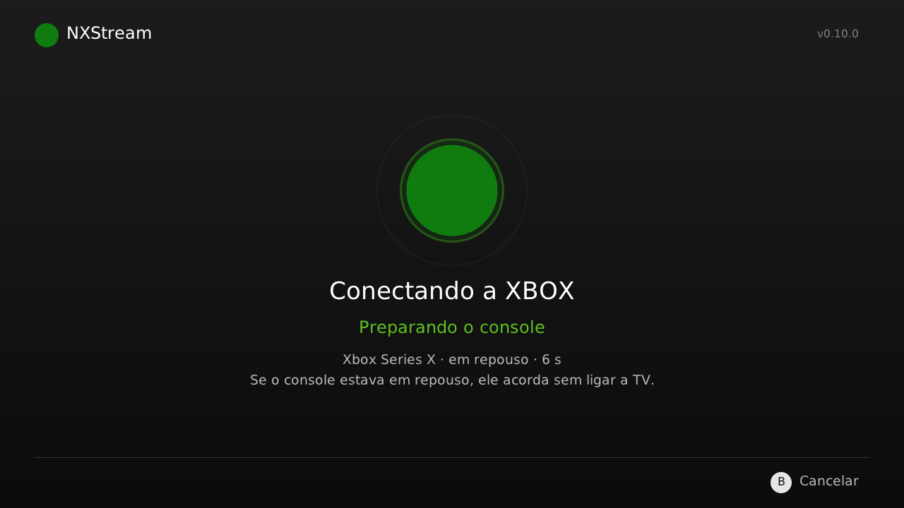 | 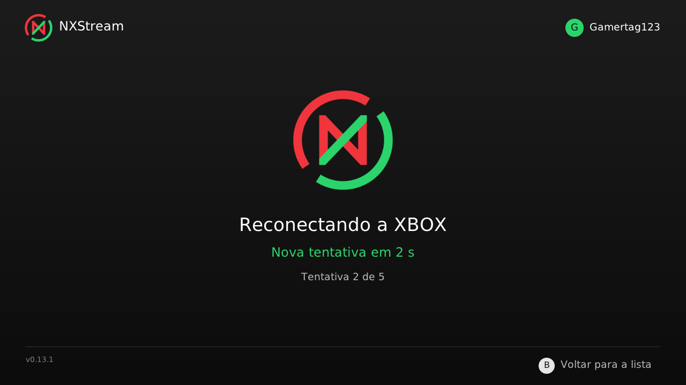 |
| **Conectando.** Logo pulsando, nome do console e o estado da sessão ("Preparando o console", "Autorizando acesso"...). B cancela e volta para a lista. | **Reconectando.** Aparece na hora em que a conexão cai ou o Switch acorda. Uma sessão nova é aberta sozinha. |

## Xbox desligado

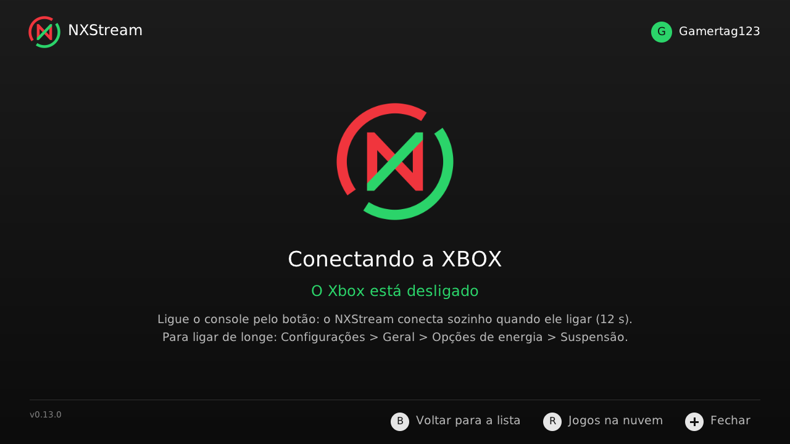

**O Xbox está desligado** (desde a v0.12.4). Aparece quando o console não atende ao chamado (desligado no modo de economia de energia). O app consulta a Microsoft a cada 5 s e conecta sozinho quando o Xbox é ligado pelo botão.

## Conta e consoles

| | |
|---|---|
| 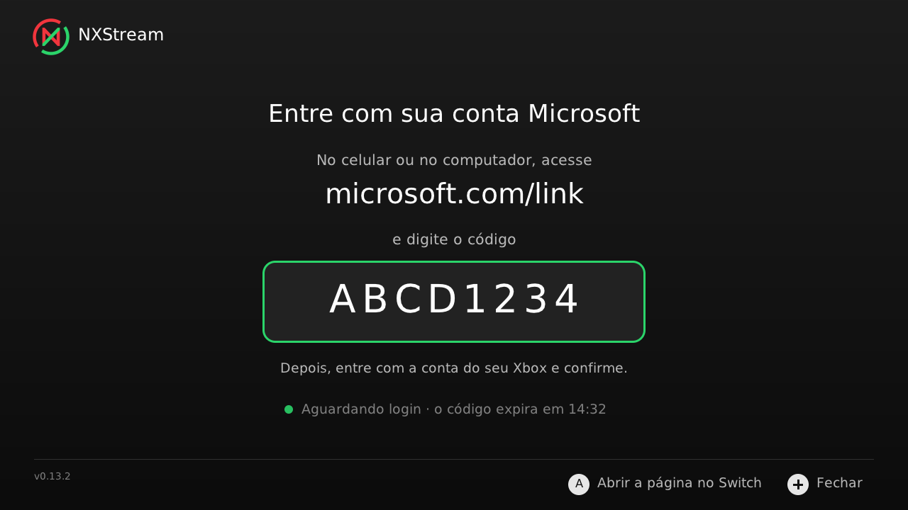 | 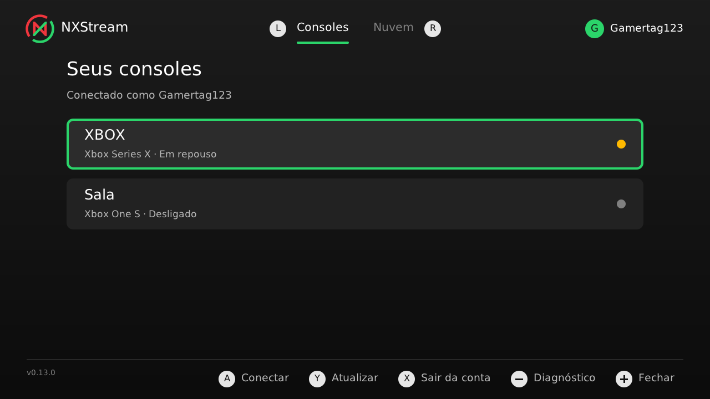 |
| **Login.** Código para digitar em microsoft.com/link no celular; A abre a página no navegador do Switch, já com o código. | **Lista de consoles.** Abas Consoles/Nuvem no topo (L/R), gamertag no canto, estado de cada console (bolinha verde: ligado; amarela: em repouso). Com um só console, a lista é pulada. |
| 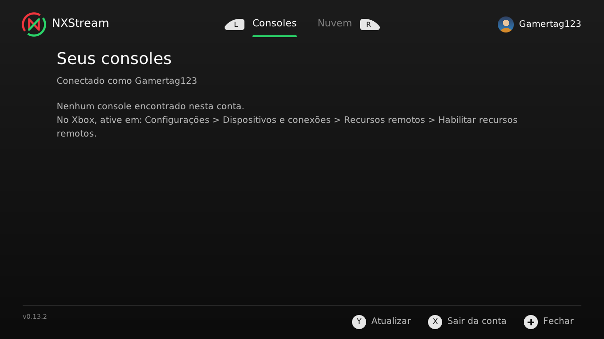 | 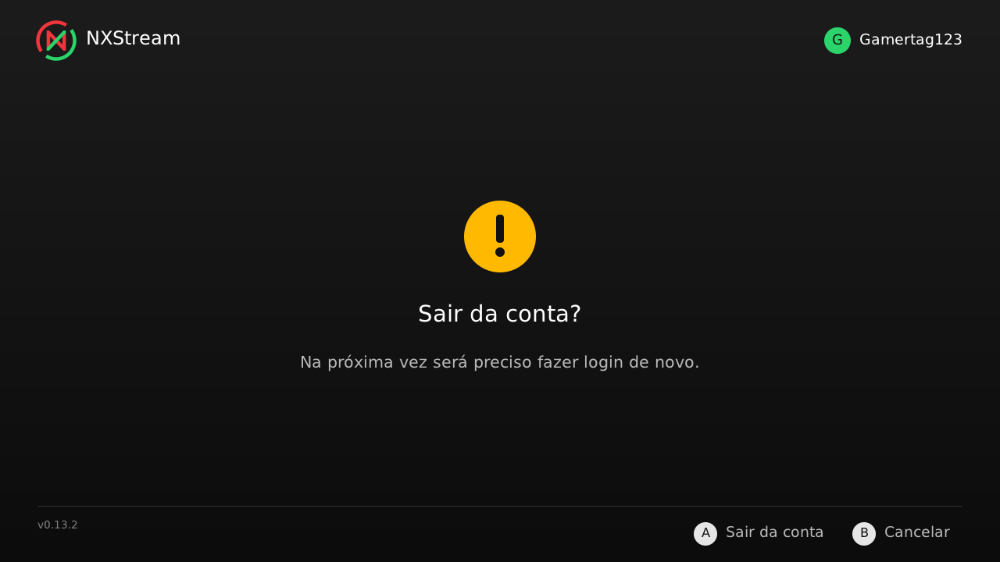 |
| **Nenhum console.** Explica onde ativar os recursos remotos no Xbox. | **Confirmação.** Perguntas e avisos com ícone. |

## Nuvem (xCloud)

| | |
|---|---|
| 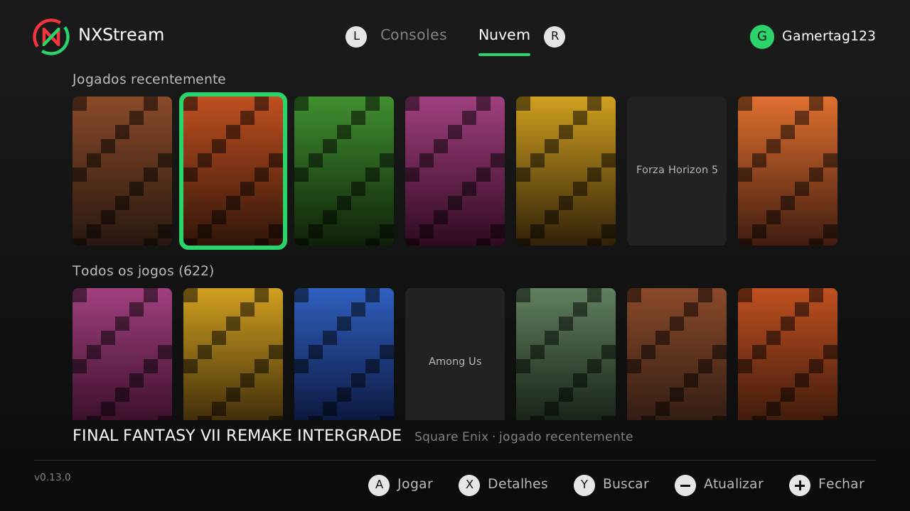 | |
| **Jogos na nuvem** (aba Nuvem, desde a v0.13.0). Faixa de recentes e grade com as capas dos jogos liberados para a conta; o selecionado tem borda verde e o nome embaixo. A joga, X detalhes, Y busca pelo teclado do Switch. Capas falsas na imagem; no Switch, as do catálogo. | |

## Durante o jogo

| | |
|---|---|
| 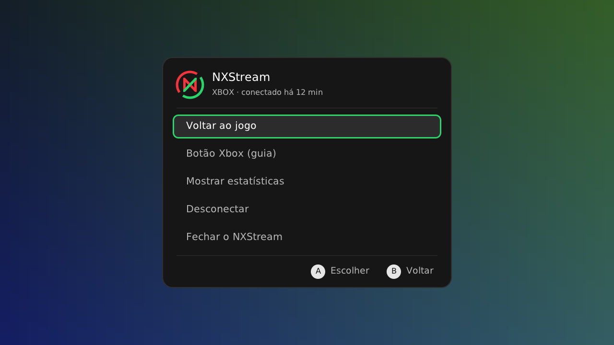 | 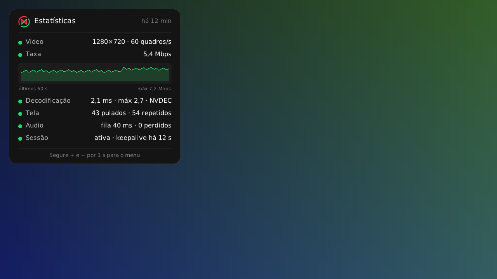 |
| **Menu** (segure + e − por 1 s). Voltar ao jogo, botão Xbox, estatísticas, desconectar, fechar. | **Estatísticas.** Cartão no canto, sem escurecer o jogo: quadros/s, taxa com gráfico de 60 s, decodificação, áudio, rede (pacotes fora de ordem, reenviados, quadros perdidos) e sessão. |

## Erros

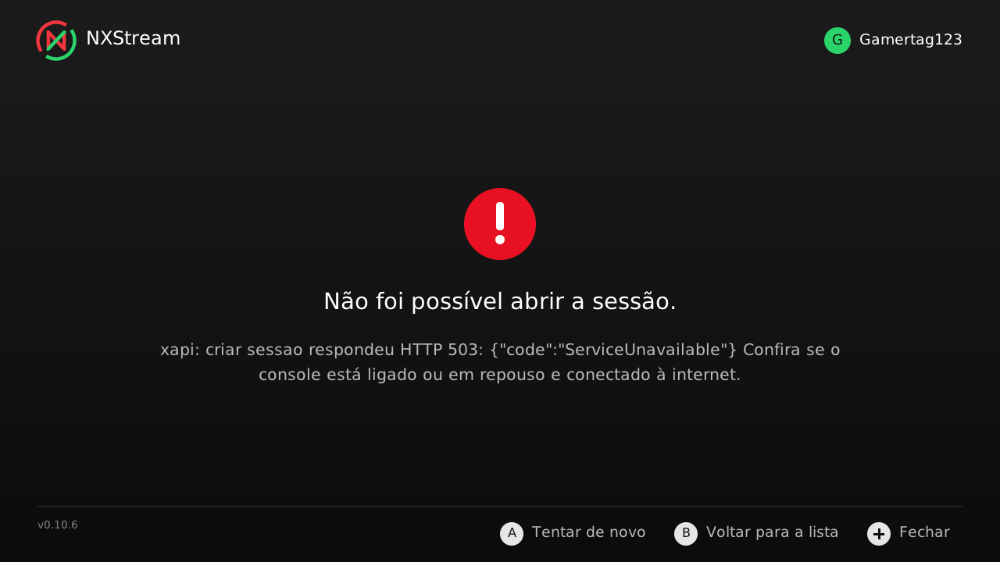

Erros mostram o que aconteceu, o detalhe técnico (útil para o log) e o que dá para fazer.
